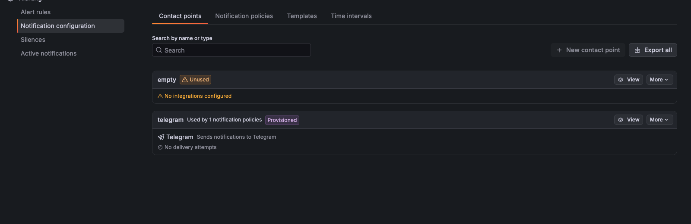
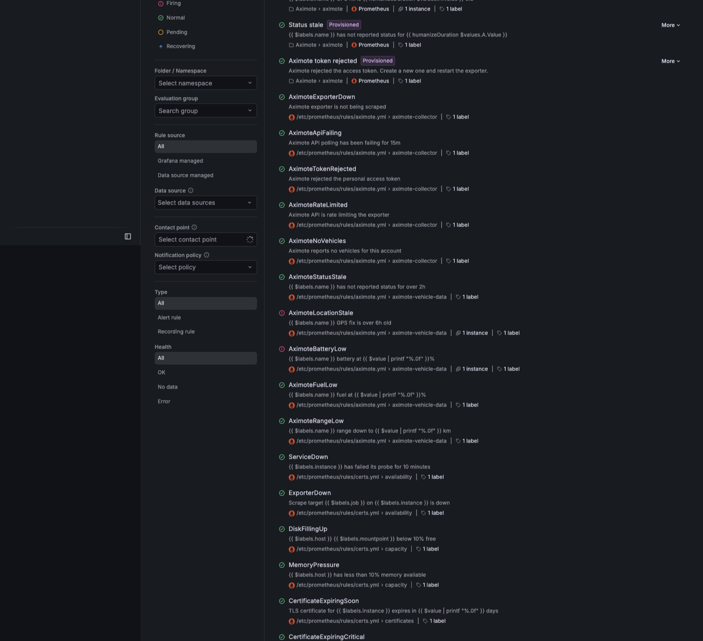

# Alerting: Telegram and Grafana

There are two ways to get aximote alerts onto your phone. Pick one.

| | A. Prometheus + Alertmanager | B. Grafana alerting |
|---|---|---|
| Rules live in | `alerts/aximote.rules.yml` (PromQL, in git) | Grafana (provisioned from `examples/stack/grafana/optional/alerting.yml`) |
| Who sends | Alertmanager | Grafana |
| Best when | you already run Prometheus | you live in Grafana and want one UI for rules, silences and contact points |
| Telegram | `telegram_configs` in `alertmanager.yml` | Telegram contact point |

Both can show up in Grafana: with A, Grafana reads Alertmanager as a datasource so the Prometheus alerts appear under **Alerting → Alert rules** next to anything else you run.

## 1. Make a Telegram bot (both paths)

1. In Telegram, message **@BotFather** → `/newbot` → pick a name. BotFather replies with the **bot token** (`123456789:AA...`).
2. Send your new bot any message (or add it to a group and post in the group).
3. Get the **chat id**:
   ```sh
   curl -s "https://api.telegram.org/bot<TOKEN>/getUpdates" | grep -o '"chat":{"id":-\{0,1\}[0-9]*'
   ```
   A private chat id is a positive number, a group id is negative.
4. Put both in `.env` (never in git):
   ```sh
   TELEGRAM_BOT_TOKEN=123456789:AA...
   TELEGRAM_CHAT_ID=987654321
   ```

Treat the bot token like a password: anyone with it can post as your bot. If it leaks, `/revoke` it in BotFather.

## A. Alertmanager → Telegram

In `examples/stack/alertmanager.yml`, replace the receivers and route with:

```yaml
route:
  receiver: telegram
  group_by: [alertname, name]
  group_wait: 30s
  group_interval: 5m
  repeat_interval: 6h

receivers:
  - name: telegram
    telegram_configs:
      - bot_token: 123456789:AA...        # Alertmanager does not read env vars here
        chat_id: 987654321                # number, not a string
        parse_mode: HTML
        message: |-
          {{ if eq .Status "firing" }}🔴{{ else }}✅{{ end }} <b>{{ .CommonLabels.alertname }}</b> · {{ .CommonLabels.name }}
          {{ range .Alerts }}{{ .Annotations.summary }}
          {{ end }}
```

Alertmanager has no env interpolation, so keep this file out of git once it holds a token (or use `bot_token_file:` pointing at a mounted secret). Then:

```sh
docker compose --profile stack restart alertmanager
docker compose --profile stack exec alertmanager \
  amtool alert add AximoteTest name="My car" summary="Test from aximote-exporter" \
  --alertmanager.url=http://localhost:9093
```

The test message arrives after `group_wait` (30 s).

### See these alerts in Grafana

The bundled Grafana already has an **Alertmanager** datasource pointing at `http://alertmanager:9093`. Open **Alerting → Alert rules** (the Prometheus rules appear under the *Prometheus* datasource) and **Alerting → Silences** to mute one from Grafana.

## B. Grafana-managed alerts → Telegram

Grafana evaluates the rules itself against the Prometheus datasource and sends to a Telegram contact point. The repo ships a provisioning file with a Telegram contact point, a notification policy and five rules (battery low, range low, location stale, status stale, token rejected).

```sh
# .env has TELEGRAM_BOT_TOKEN and TELEGRAM_CHAT_ID
docker compose -f compose.yaml -f compose.grafana-alerts.yaml --profile stack up -d
```

`compose.grafana-alerts.yaml` mounts `examples/stack/grafana/optional/alerting.yml` into Grafana's provisioning folder and passes the two Telegram variables through. It is a separate file because Grafana refuses to start with a Telegram contact point that has no token.

These files were loaded into a clean Grafana 13.3.1 against a live car before publishing: all five rules, the contact point and the policy provisioned without errors.





In Grafana:

- **Alerting → Contact points → telegram → Test** sends a test message right away.
- **Alerting → Alert rules → Aximote** lists the five rules; edit thresholds there or in the YAML.
- Provisioned rules are read-only in the UI by design. Change the YAML and restart Grafana, or copy a rule to make an editable one.

Use A or B, not both, unless you want two messages per alert.

## Choosing thresholds

The defaults are a starting point:

| Rule | Default | Consider |
|---|---|---|
| Battery low | < 20 % for 30 min | your usual overnight top-up level |
| Range low | < 50 km for 30 min | your longest regular trip plus a margin |
| Location stale | GPS older than 6 h | shorter if the car is used daily |
| Status stale | status older than 2 h | the agent reports less often when the car sleeps |

Every reading has its own capture time (see the README), so stale alerts fire per reading. A green status with a stale GPS fix is normal for a parked car.
